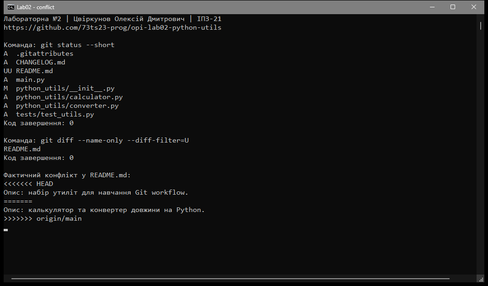
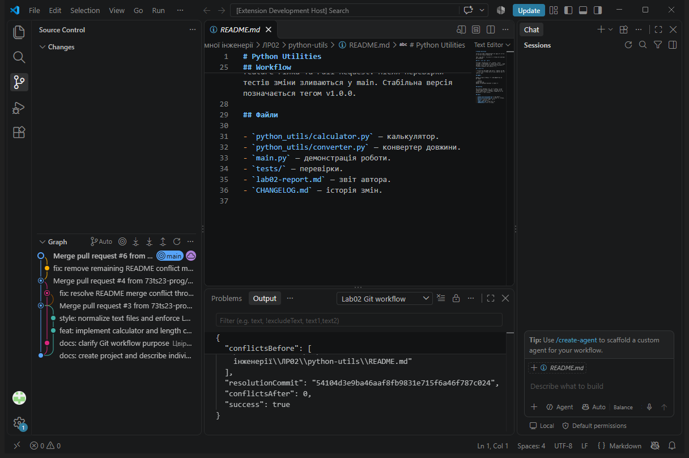
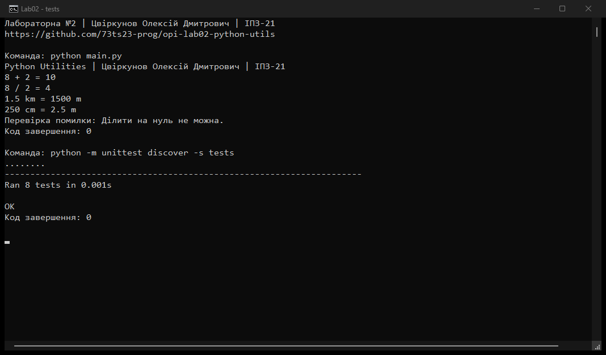

# Лабораторна робота №2

**Тема:** Налаштування середовища розробки та Git workflow.

**Виконав:** Цвіркунов Олексій Дмитрович.

**Група:** ІПЗ-21.

**Роль:** розробник; перевірку та документацію також виконано в межах індивідуальної роботи.

**Репозиторій:** https://github.com/73ts23-prog/opi-lab02-python-utils

## Мета

Навчитися працювати з Git, гілками, Pull Request, конфліктами злиття, Issues та релізами GitHub.

## Формат виконання

Роботу виконано індивідуально за вибором студента. Методичка передбачає команду з 3–4 осіб; команду, внески інших людей та незалежне схвалення PR не імітовано. Технічні операції продемонстровано на гілках одного автора. Погодження індивідуального формату з викладачем не підтверджено.

## Налаштування та проєкт

Використано Git 2.56.0, GitHub, Python 3.14.7 та VS Code 1.143.1. У локальному репозиторії налаштовано ім’я автора, GitHub noreply email і `pull.rebase=false`; основну гілку створено як `main`.

Доступ до GitHub налаштовано через HTTPS і GitHub CLI з інтеграцією Git Credential Manager. Методичка допускає HTTPS, якщо SSH не налаштовано. Приватні ключі й токени в репозиторій не додавалися.

**2FA:** увімкнено на акаунті `73ts23-prog` за підтвердженням студента від 05.11.2026. Налаштування автентифікатора виконано на особистому iPhone; QR-коди, секрети та коди відновлення до репозиторію не додавалися.

Створено калькулятор і конвертер довжини між метрами, кілометрами та сантиметрами. Сторонніх Python-бібліотек не потрібно. Опис і команди запуску наведено в [README.md](README.md), зміни — у [CHANGELOG.md](CHANGELOG.md).

```console
python main.py
python -m unittest discover -s tests -v
```

## Особистий внесок

| Завдання | Гілка | Результат |
|---|---|---|
| Калькулятор, конвертер і тести | `feature/python-utilities` | [PR №3](https://github.com/73ts23-prog/opi-lab02-python-utils/pull/3), [Issue №1](https://github.com/73ts23-prog/opi-lab02-python-utils/issues/1) |
| Опис проєкту та конфлікт злиття | `docs/project-description` | [PR №4](https://github.com/73ts23-prog/opi-lab02-python-utils/pull/4), [Issue №2](https://github.com/73ts23-prog/opi-lab02-python-utils/issues/2) |
| Виправлення залишкових маркерів | `fix/readme-conflict-markers` | [PR №6](https://github.com/73ts23-prog/opi-lab02-python-utils/pull/6), [Issue №5](https://github.com/73ts23-prog/opi-lab02-python-utils/issues/5) |

Основні коміти:

- [55055bf](https://github.com/73ts23-prog/opi-lab02-python-utils/commit/55055bf) — початкова структура й README.
- [abde60c](https://github.com/73ts23-prog/opi-lab02-python-utils/commit/abde60c) — утиліти та тести.
- [54104d3](https://github.com/73ts23-prog/opi-lab02-python-utils/commit/54104d3) — merge-коміт через Git API VS Code.
- [7c39dae](https://github.com/73ts23-prog/opi-lab02-python-utils/commit/7c39dae) — видалення залишкових маркерів у README.

Для роботи виконано `git init`, `add`, `commit`, `push`, `fetch`, `switch`, `merge`, `clone` і `pull`. PR пов’язано з Issues через `Closes #1`, `Closes #2` і `Closes #5`. Усі три PR злиті в `main`. Issues №1 і №2 закрито автоматично; Issue №5 закрито після фінальної перевірки виконаного виправлення.

## Конфлікт злиття

Дві гілки створено від початкового `main`. В одній змінено опис на калькулятор і конвертер, у другій — на навчання Git workflow. Після злиття першого PR у `main` команда `git merge origin/main` у другій гілці спричинила конфлікт README.



Рисунок 1 — фактичний стан конфлікту. Git позначив README як `UU` та додав маркери двох версій.

Обидва описи об’єднано в рядок: «Опис: калькулятор та конвертер довжини для навчання Git workflow». Збереження файла, додавання до індексу та merge-коміт виконано через API редактора і вбудованого розширення `vscode.git` у VS Code. Панель Source Control показує гілки та коміти.

Під час перегляду IDE-скріншота знайдено ще один блок маркерів біля списку файлів. Його виправлено через PR №6. Після цього всі відстежувані текстові файли перевірено на залишкові маркери конфлікту.



Рисунок 2 — README після виправлення та історія Git у VS Code. У фінальному файлі маркерів конфлікту немає.

## Перевірка

Репозиторій склоновано у свіжу папку. Виконано `git pull --ff-only`, запуск програми та всі 8 тестів — помилок немає. `.gitignore` виключає кеш Python, віртуальне середовище, `.env` та службові налаштування IDE; `.gitattributes` задає LF для текстових файлів.



Рисунок 3 — результати калькулятора й конвертера. Усі 8 тестів пройдено, ділення на нуль оброблено повідомленням.

## Реліз

Створено тег `v1.0.0` і [GitHub Release v1.0.0](https://github.com/73ts23-prog/opi-lab02-python-utils/releases/tag/v1.0.0). Реліз містить утиліти, тести, звіт і скріншоти; зміни описано в CHANGELOG.md.

## Контрольні запитання

**1. Які переваги має розподілена система контролю версій Git порівняно з централізованими системами?**

Кожен розробник має повну копію історії. Коміти й робота з гілками доступні без інтернету, а копії репозиторію допомагають відновити дані.

**2. Як організувати ефективний Git workflow для команди розробників?**

Розподілити завдання через Issues, для кожного створювати окрему гілку. Зміни перевіряти через PR і тести, після чого зливати в main.

**3. Які кроки необхідно виконати для вирішення конфлікту при злитті гілок?**

Знайти конфліктні файли через git status, об’єднати потрібні зміни та прибрати всі маркери. Потім виконати git add, commit, перевірку й push.

**4. Як Pull Request допомагає підтримувати якість коду в командній розробці?**

PR показує зміни перед злиттям. Інші учасники можуть знайти помилки, залишити зауваження та перевірити результати тестів.

**5. Які стратегії допомагають запобігти конфліктам у командній розробці?**

Регулярно оновлювати гілки, робити невеликі зміни та узгоджувати редагування спільних файлів. Завершені гілки варто зливати без тривалих затримок.

**6. Як правильно вирішувати merge конфлікти та які інструменти для цього використовувати?**

Потрібно зрозуміти призначення обох змін і зберегти потрібний результат. Допомагають git diff, git status та редактор злиття VS Code; після виправлення слід перевірити всі блоки й запустити тести.

## Висновок

На навчальному проєкті продемонстровано роботу з гілками, Pull Request, Issues та конфліктом злиття. Програму перевірено після клонування; індивідуальний формат виконання й фактичний стан налаштувань зазначено окремо.

## Джерело

[Методичка лабораторної №2](https://github.com/olroi421/course-opi-v2/blob/main/labs/lab-02.md).
